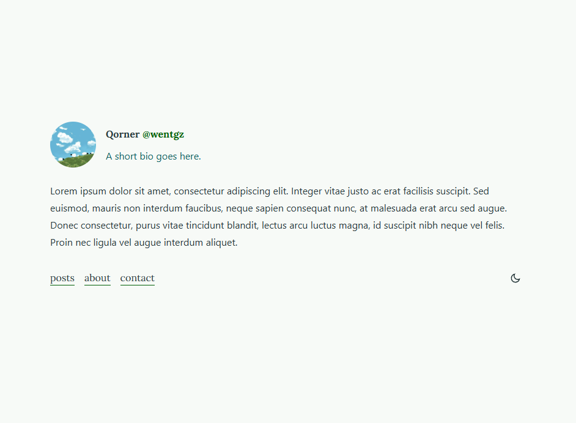
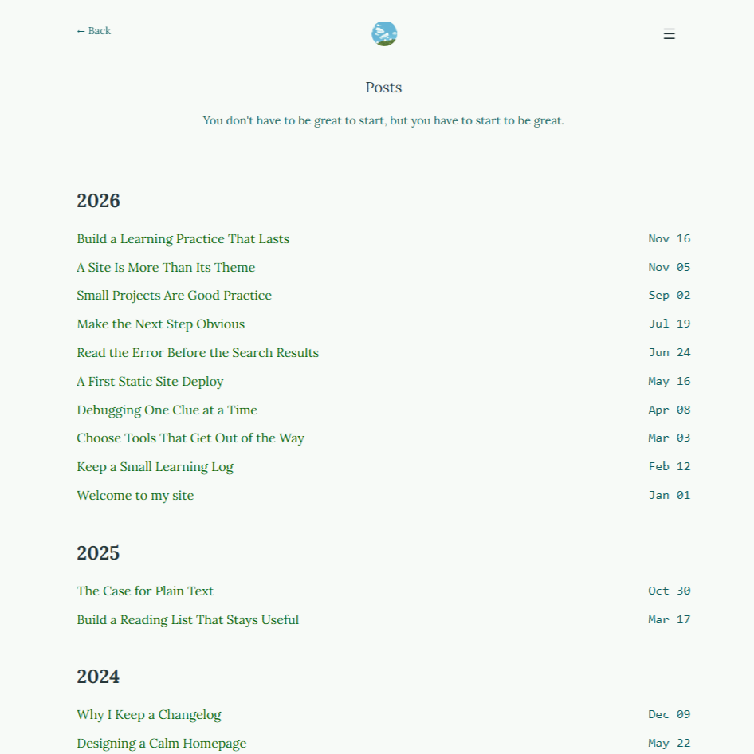
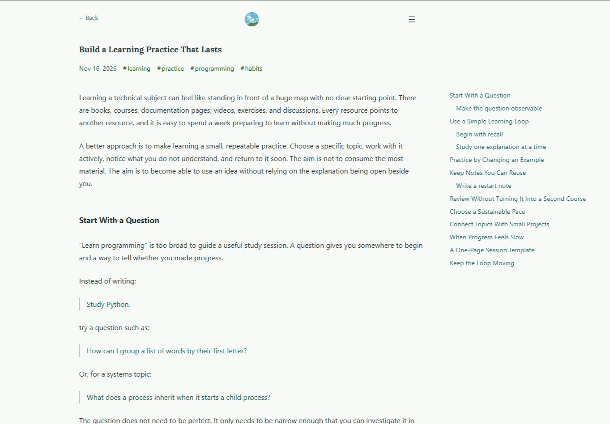

# Qorner

A quiet blog theme for [Zola](https://www.getzola.org/).

**Live demo:** [Visit the blog](https://qorner.pages.dev)

## Preview







## Run locally

```sh
zola serve
```

Open the local URL printed by Zola (usually `http://127.0.0.1:1111`). Zola rebuilds the site when you edit files.

Alternatively, with Docker Compose:

```sh
docker compose up --build
```

## Build for deployment

```sh
zola build
```

## Notes

- **Qorner** is a fork of [Serene](https://github.com/isunjn/serene), which is distributed under the MIT License. The original license notice is included in `LICENSE`.